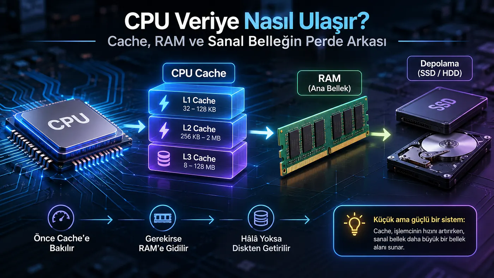
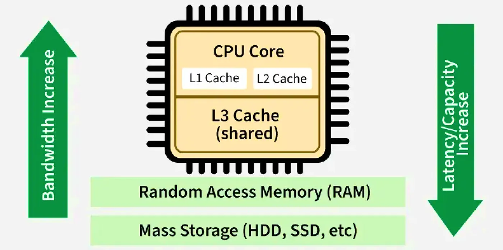
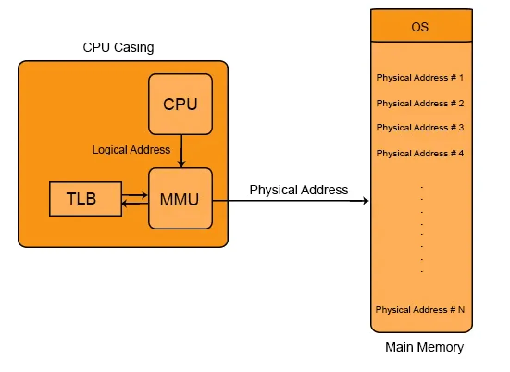

Tarih: 5 kasım 2026  
Konu: İşletim sistemlerinde cache memory nedir ?  

**Cache memory,** *modern cpu'larda (işlemci) bulunan bir bellek türüdür. Bu bellek türü, işlemcinin sık sık erişmesi gereken verileri saklamakla görevlidir. *  

**Cache memory'nin amacı nedir? **  
*Cache memory'nin amacı işlemcinin sürekli ram'e gitmesini önleyerek işlemci tarafından sıkça istenen verileri kendi içerisinde tutmak. *  

**Cache memory içerisinde saklanan veriler nelerdir ? **  
*- Sistemde çalışan programlara ait makine kodları,*

*- Hesaplama sırasında kullanılan sayılar,*  
*- Bir dosyanın, videonun veya fotoğrafın diskte yüklendiği bölümler,*  
ve daha bir çok veri cache memory içerisinde tutulmaktadır.  

Cache memory 3 bölümden oluşmaktadır bu bölümler sırasıyla L1, L2 ve L3 bölümleri olarak isimlendirilmektedir. Her bir bölüm arttıkça tuttuğu veri artmakla beraber performansıda düşmektedir.  

Örneğin en az veri L1 seviyesinde tutulurken (32 - 128 kb) en hızlı performansıda L1 katmanı sağlamaktadır. L2, L1'den daha fazla (256kb - 2mb) veri tutarken L1'den daha düşük performansa sahiptir aynı şekilde L3, L2'den daha fazla veri (8 - 128mb) tutabilirken L2'den daha düşük performansa sahiptir.  

L1 Katmanı içerisinde çekirdek başına 32 - 128kb arasında veri tutabilmektedir.  
L2 Katmanı içerisinde çekirdek başına 256kb - 2mb arasında veri tutabilmektedir.  
L3 Katmanı içerisinde ise genellikle 8mb - 128mb arasında veri tutabilmektedir.  

&nbsp;

Ek not: Daha modern işlemcilerde L3 Katmanında 96mb - 256mb'e kadar veri tutulabilmektedir. AMD 3D V-Cache teknolojisi barındıran işlemciler bunun birer örneğidir. Benzer durum L2 içinde geçerlidir modern işlemcilerde L2'de tutulan veri çekirdek başına 2mb olmak üzere 12mb - 32mb arasında değişkenlik gösterebilir. L1 katmanı ise biraz daha değişkenlik gösterir sebebi işlemcilerin her çekirdeğinde L1 Katmanı bulunuyor ve genelde her çekirdek başına 64 kb veri tutulduğunu varsayarsak 12 çekirdekli bir işlemcide 768kb L1 önbelleği bulunduğunu söyleyebiliriz.  

İşlemcideki her çekirdekte kendisine ait özel L1 ve L2 çekirdekleri bulunmaktadır ve buradaki verileri diğer çekirdeklerle paylaşmazlar ancak L3 çekirdeği işlemcinin ram'e olan ihtiyacını azaltmak için bütün çekirdeklerle ortak birşekilde çalışır veri paylaşır bu yapıya shared yapı denmektedir. Bundan dolayı kendisinden önce gelen L1 ve L2'den daha büyük veriler tutabilmektedir daha büyük veri tutmasından dolayıda daha ağır çalışmaktadır. Ancak bu düşük performans sizi yanlış düşünceye yöneltmesin işlemcide bulunan l3 katmanı bile ram'den kat ve kat daha hızlı şekilde çalışmaktadır. L3'ün bir önceki katmanlardan ağır çalışma sebebide sadece büyük veri içermesinden ziyade çekirdeğe olan mesafesinden kaynaklanmaktadır işlemci çekirdeği veriyi ararken sırayla L1 > L2 > L3 > RAM > SSD / HDD diye ilerler aradaki mesafeden dolayı L3 katmanı bir önceki katmanlara göre daha ağır çalışmaktadır.  

Aynı zamanda L1 Katmanını L2 ve L3 katmanlarından ayıran bir diğer yapısı ise L1i ve L1D Katmanlarıdır.   
L1i: işlemcinin kullanacağı komutları barındırır. (32 kb)  
L1d: işlemcinin kullanacağı veriler. (32 kb)  

L1 ve L2 Katmanları ait oldukları çekirdeğe özelken L3 Katmanını işlemcideki bütün çekirdekler tarafından ortaklaşa (shared yapı) kullanılır.   

Bu arada Cache memory kavramını anlatırken işlemcinin buradaki veriyi nasıl çağırdığını anlatmadanda geçmek istemem. İşlemci, istediği veriyi çağırmak için Cache controller veya türkçesiyle cache kontrolcüsü denen bir mekanizma kullanmaktadır bu mekanizma, işlemcinin istediği veriyi katmanlar arasında arayıp işlemciye iletmekten sorumludur.   

**Peki işlemcinin aradığı veri hem Cache Memory hemde RAM içerisinde bulunmuyorsa ne olacak ? **  
Durum burada birazıcık karmaşıklaşmaktadır :D işlemci veriyi aradığını Cache controller'e göndererek önce verinin cache katmanlarında (l1-l2-l3) aranmasını sağlar. (Bu arada işlemcinin istediği veri bir sanal adrestir buna başka bir derste değineceğim.) Cache controller, işlemciden aldığı arama isteği üzerine L1 L2 ve L3 Katmanlarında istenen veriyi arar eğer bu veriyi bulursa işlemciye "Cache hit." mesajı olarak ışık hızında iletir bu durumda istenen veri kaç taneyse o kadar cache hit gönderilir örneğin işlemci 10000 adet veri istiyorsa ve bu verilerin 8500 tanesi cache controller tarafından L1 - L2 - L3 Katmanlarında bulunduysa işlemciye "8500 cache hit." mesajı gönderilir. Eğer aranan veri bulunamazsa bu durumda da "Cache miss." mesajı işlemciye gönderilir ve burada devreye MMU yani Management Memory Unit girer. (Bana göre MMU fizik derslerinde anlatılması gereken muhteşem birşey) Öncelikle şunu bilmeniz gerekir Ram'da tutulan veriler tamamen fiziksel adreslerden oluşurken işlemcinin istediği veriler ise sanal adreslerden yani sanal bellekte tutulan adreslerden oluşmaktadır. MMU'nun görevi ise işlemcinin istediği sanal adresin, Ram içerisindeki fiziksel yani gerçek adreslerini bulup bunu anakarttaki veri taşıyıcılarına (bus) gönderir veri taşıyıcıları ise aldığı fiziksel adresi iletir. Veri taşıyıcıları ise aldıkları bu fiziksel adresin verilerini Ram'de kontrol edip doğruladıktan sonra veriyi işlemciye iletir.  

Özetle Cache controller, işlemcinin istediği veriyi L1 - L2 - L3 katmanlarında aramaktan görevliyken,  
MMU ise işlemcinin istediği sanal adresi, fiziksel adrese çevirip bu adresi veri taşıyıcılarına gönderir. Veri taşıyıcıları ise aldığı fiziksel adresin Ram'deki veri karşılığını doğruladıktan sonra bu veriyi işlemciye iletir.  

Buraya kadar işlemcinin cache ile ram arasındaki iletişiminden bahsettik peki işlemcinin istediği veri ram'da bulunmuyorsa o durumda ne yapacağız :D o durumda da zurnanın zırt dediği yere geldik diyoruz.  

**MMU Page Fault nedir? **  
İşlemcinin istediği veri MMU'nun Sayfa Tablosu (Page Table) üzerinde aranır. (Page table kısaca, hangi sanal adresin hangi fiziksel adrese eşleştirildiğini tutan bir tablo) MMU, işlemcinin istediği verinin Ram üzerinden silindiğini veya daha önce Ram'a yazılmadığını tespit ederse haliyle SSD / HDD üzerinde de arama yetkisi olmadığından dolayı işlemciye çok güçlü bir acil durum sinyali gönderir. Bu sinyale Page Fault (Sayfa hatası) kesmesi (interrupt) denir. MMU'dan acil durum sinyali alan işlemci o anki işlemini dondurup devreye işletim sistemini (Kernel) sokar. İşletim sistemi bu durumda disk kontrolcüsüne talimat vererek istenen veriyi disk üzerinde araştırır ve veriyi bulup Ram üzerine yazar. Ram üzerine veri yazıldıktan sonra işletim sistemi, MMU'a istediği verinin Ram'a yazıldığını ve verinin fiziksel adresi ile sanal adresinin Page Table üzerinde güncellenmesini söyler. Page Table güncellendikten sonra işlemci tekrar veri talebinde bulunur ve bu veri tekrar Cache Controller üzerinde (L1-L2-L3 Katmanlarında) aranır bulunmadığı takdirde devreye MMU girer. MMU Verinin sanal adresi ile fiziksel adresini kendi sayfa tablosunda karşılaştırır bulduktan sonra bu fiziksel adresi anakarttaki veri ileticilerine göndererek işlemciye gönderilmesini sağlar.   

Peki buraya kadar okurken hiç işletim sisteminin veriyi ram üzerine yazarken Ram'ın dolu olmasından dolayı nasıl bir yol izleyeceğini düşündünüz mü ? Kısaca ram doluyken işletim sistemi bu veriyi nasıl yazar diye düşündünüz mü ? Cevabınız evet ise okumaya devam edebilirsiniz. İşletim sistemi bulduğu veriyi Ram'a yazmak üzereyken Ram'ın dolu olduğunu görürse bu durumda Ram üzerinde yer kaplayıp uzun bir süredir kullanılmayan veriyi disk üzerine kayıt eder (Page out işlemi) yani veri Ram'den silinip SSD / HDD üzerine kayıt edilir. Silinen veriden boşa kalan yere ise işlemcinin istediği veri yazılır.   

Peki buraya kadar okuduysanız öncelikle teşekkür ederek bir diğer soruya sizi davet ediyorum.  
**Soru**: Daha önce bilgisayarınızın anlık veya uzun süreli neden donduğunu hiç düşündünüz mü ? Cevabınız evet ise bunun sorumlusunun Page Fault olduğunu bilmenizi isterim peki Sistemin Page Fault'tan kasma sebebi nedir diye soracak olursanız o durumda da hiç bekletmeden açıklamak isterim. İşlemci nin istediği veri Cache memory veya Ram üzerinde bulunmadığından dolayı işlemci o anki işlemi dondurup topu işletim sistemine atıyor. Topu alan işletim sistemi ise veriyi sistemdeki diskiniz üzerinde arıyor bu süre Ram üzerinde veri arama işleminden kat ve kat daha uzun sürebiliyor (Diskin okuma / yazma hızı burada çok önemli rol oynuyor) işletim sistemi disk üzerinde arama yaptığı süre boyunca işlemci ondan yapılacak geri dönüşü bekliyor ve bu süre boyunca işlemci yaptığı işlemi donduruyor. Bundan dolayıda anlık veya uzun süreli donmalar yaşanmaktadır.  

Yazar: Onur Kazan